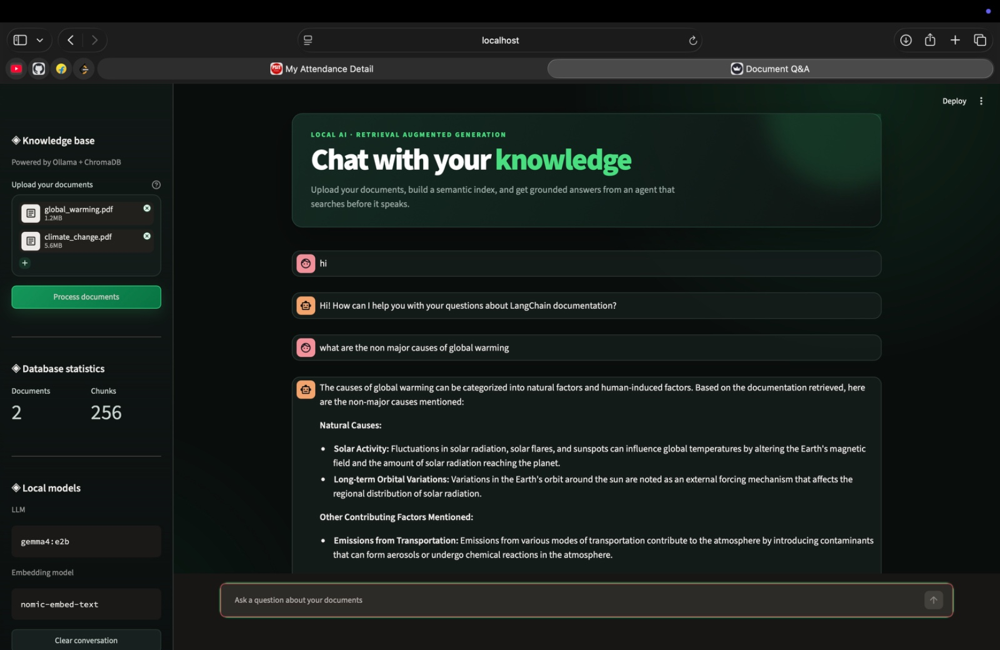

# Local AI Agentic RAG Document Assistant

> A locally powered Agentic RAG application that lets you upload PDF, TXT, and Markdown documents and ask context-aware questions through a Streamlit interface. Built with LangChain, DeepAgents, Ollama, Gemma 4, Nomic Embeddings, and persistent ChromaDB.


---



## What Is This?

This project is a learning-focused **Agentic Retrieval-Augmented Generation (RAG) application** designed to answer questions using user-provided documents.

Instead of relying entirely on a language model's pretrained knowledge, the application retrieves relevant information from uploaded documents and uses it as context for generating grounded answers.

The project uses locally running AI models through Ollama, eliminating the need for paid cloud LLM and embedding APIs.

The application demonstrates two related workflows:

- **Streamlit Application (`main.py`)** — Upload PDF, TXT, or Markdown documents, index them into ChromaDB, and interact with your knowledge base through a chat interface.
- **Terminal Agent (`agent.py`)** — Run the DeepAgents workflow directly from the terminal using the shared retrieval backend.

The project focuses on understanding document ingestion, semantic search, persistent vector storage, agent orchestration, and multi-agent collaboration.

---

## Demo


The Streamlit dashboard provides document uploading, indexing, database statistics, and conversational document-based question answering through a locally running AI model.

---

## Features

- Upload multiple PDF, TXT, and Markdown documents.
- Extract PDF content page by page using `pypdf`.
- Split documents into overlapping chunks.
- Generate embeddings locally using Ollama's `nomic-embed-text`.
- Generate answers using the local `gemma4:e2b` model.
- Store document embeddings persistently using ChromaDB.
- Perform semantic similarity search across indexed documents.
- Detect duplicate and modified documents using SHA-256 hashing.
- Avoid unnecessary re-embedding of unchanged documents.
- Save retrieved passages to the DeepAgents virtual filesystem.
- Delegate document analysis to specialist `chunk-analyst` subagents.
- Coordinate multiple document-analysis tasks through DeepAgents.
- Preserve conversation messages during the active Streamlit session.
- Display database statistics, including indexed documents and chunks.
- Run the application without Mistral or OpenAI API dependencies.

---

## How It Works

The application follows an agentic RAG pipeline:

1. **Ingest** — Users upload PDF, TXT, or Markdown documents.
2. **Parse** — PDF pages are extracted using `pypdf`; text and Markdown files are decoded as UTF-8.
3. **Chunk** — `RecursiveCharacterTextSplitter` divides documents into smaller overlapping chunks.
4. **Hash** — SHA-256 identifies document content and helps detect duplicates or modifications.
5. **Embed** — Ollama's `nomic-embed-text` converts document chunks into 768-dimensional vectors.
6. **Index** — Chunks, metadata, and vectors are stored persistently in ChromaDB.
7. **Retrieve** — The agent invokes `search_documentation` to retrieve relevant document chunks.
8. **Delegate** — Retrieved chunks are saved under `/retrieved/` in the DeepAgents virtual filesystem and assigned to specialist subagents.
9. **Analyze** — Chunk analysts examine the retrieved information and return concise summaries.
10. **Synthesize** — The coordinating agent combines the evidence into a final response.

### Architecture

```text
          PDF / TXT / Markdown
                    |
                    v
             Document Loading
                    |
                    v
              Text Extraction
                    |
                    v
             Document Chunking
              (1000 / 200)
                    |
                    v
           SHA-256 File Hashing
                    |
                    v
             Ollama Embeddings
             (Nomic Embed)
                    |
                    v
               ChromaDB
          (Persistent Storage)
                    |
                    v
             Semantic Search
                    |
                    v
             Retrieved Chunks
                    |
                    v
             DeepAgents Agent
                    |
          +---------+---------+
          |                   |
          v                   v
     Chunk Analyst       Chunk Analyst
       Subagent             Subagent
          |                   |
          +---------+---------+
                    |
                    v
             Result Synthesis
                    |
                    v
             Gemma 4 (Ollama)
                    |
                    v
              Final Answer
```

---

## Project Structure

```text
RAG/
|
+-- main.py                 # Streamlit application and chat interface
+-- agent.py                # DeepAgents configuration and CLI entry point
+-- filereader.py           # PDF extraction utilities
+-- indexing.py             # Ollama embeddings and ChromaDB indexing
+-- tools.py                # Semantic retrieval tool and agent backend
+-- prompts.py              # Agent and subagent instructions
|
+-- pdf/                    # Local sample PDF documents
|   +-- climate_change.pdf
|   +-- global_warming.pdf
|
+-- chroma_db/              # Persistent ChromaDB storage
|
+-- src/
|   +-- rag/
|       +-- __init__.py
|
+-- .env                    # Optional environment configuration
+-- .gitignore
+-- .python-version
+-- pyproject.toml           # Project metadata and dependencies
+-- uv.lock                 # Dependency lockfile
+-- README.md
```

### Module Responsibilities

| File | Responsibility |
|---|---|
| `main.py` | Streamlit UI, document uploading, processing, chat, and session state |
| `agent.py` | Creates the local DeepAgent and configures the chunk-analyst subagent |
| `filereader.py` | Extracts PDF text page by page into LangChain Documents |
| `indexing.py` | Handles document hashing, chunking, embeddings, and persistent ChromaDB storage |
| `tools.py` | Provides semantic document search and saves retrieved chunks to the agent filesystem |
| `prompts.py` | Defines workflow, delegation, and chunk-analysis instructions |

---

## Getting Started

### Prerequisites

| Requirement | Purpose |
|---|---|
| Python 3.12+ | Application runtime |
| uv | Dependency and environment management |
| Ollama | Local model runtime |
| Gemma 4 (`gemma4:e2b`) | Local language model |
| Nomic Embed (`nomic-embed-text`) | Local embedding model |
| ChromaDB | Persistent vector database |

### 1. Install Ollama

Download Ollama from:

https://ollama.com/download

Verify installation:

```bash
ollama --version
```

### 2. Download the Required Models

Download the language model:

```bash
ollama pull gemma4:e2b
```

Download the embedding model:

```bash
ollama pull nomic-embed-text
```

Verify installed models:

```bash
ollama list
```

Expected models:

```text
NAME
gemma4:e2b
nomic-embed-text:latest
```

### 3. Clone the Repository

```bash
git clone https://github.com/Adityarific/Rag-Studio.git

cd RAG
```

### 4. Install Dependencies

```bash
uv sync
```

The command creates the virtual environment and installs the dependencies defined in `pyproject.toml`.

If setting up the project dependencies manually:

```bash
uv add deepagents langchain-ollama langchain-chroma langchain-text-splitters streamlit pypdf python-dotenv
```

### 5. Start Ollama

Make sure the Ollama service is running.

On macOS, opening the Ollama application starts the local service.

You can verify the model connection by running:

```bash
ollama run gemma4:e2b
```

### 6. Launch the Streamlit Application

```bash
uv run streamlit run main.py
```

Open the local URL printed in the terminal, usually:

```text
http://localhost:8501
```

---

## Using the Application

1. Open the Streamlit application.
2. Upload one or more PDF, TXT, or Markdown documents using the sidebar.
3. Click **Process documents**.
4. The application extracts text, generates local embeddings, and stores the chunks in ChromaDB.
5. Ask questions using the chat interface.
6. The agent searches the indexed documents and delegates chunk analysis to specialist subagents.
7. Review the generated response.

### Persistent Storage

Unlike an in-memory vector store, ChromaDB maintains its indexed data on disk.

```text
RAG/
|
+-- chroma_db/
    +-- chroma.sqlite3
    +-- ...
```

This allows previously indexed documents to remain available after restarting the application.

Unchanged files can be skipped using their SHA-256 hashes, while modified files can be re-indexed.

---

## Run the Terminal Agent

The project also provides a terminal-based entry point.

Run:

```bash
uv run python agent.py
```

This creates the DeepAgent and executes the example question defined in `agent.py`.

The terminal agent and Streamlit application use the shared indexing and retrieval modules.

---

## Tech Stack

| Layer | Technology | Role |
|---|---|---|
| Language | Python 3.12+ | Application runtime |
| UI | Streamlit | Document upload and conversational interface |
| RAG Framework | LangChain | Document processing, splitting, embeddings, and retrieval |
| Agent Framework | DeepAgents | Agent orchestration and subagent delegation |
| LLM Runtime | Ollama | Local model execution |
| Language Model | Gemma 4 (`gemma4:e2b`) | Answer generation and agent reasoning |
| Embedding Model | Nomic Embed (`nomic-embed-text`) | Local document and query embeddings |
| Vector Database | ChromaDB | Persistent vector storage and semantic search |
| PDF Parsing | pypdf | PDF text extraction |
| Configuration | python-dotenv | Environment configuration |
| Package Manager | uv | Dependency and environment management |

---

## Configuration

The main configuration values are currently defined in the project code.

| Setting | Current value | Location |
|---|---|---|
| Chat model | `gemma4:e2b` | `agent.py` |
| Embedding model | `nomic-embed-text` | `indexing.py` |
| Embedding dimensions | `768` | Nomic Embed output |
| Vector database | ChromaDB | `indexing.py` |
| Collection name | `climate_knowledge` | `indexing.py` |
| Database directory | `./chroma_db` | `indexing.py` |
| Chunk size | `1000` characters | `indexing.py` |
| Chunk overlap | `200` characters | `indexing.py` |
| Retrieved chunks | `2` | `tools.py` |
| Concurrent analysts | `3` | `agent.py` |

The model names can be changed to other compatible models available through Ollama.

---

## Key Learning Concepts

### 1. Retrieval-Augmented Generation

RAG provides the language model with relevant passages retrieved from a document corpus at question time.

This helps generate responses grounded in the user's own documents rather than relying entirely on pretrained model knowledge.

### 2. Embeddings

Embeddings represent text as numerical vectors.

The application uses Nomic Embed through Ollama to convert document chunks and search queries into 768-dimensional vectors.

### 3. Vector Databases

ChromaDB stores document vectors alongside their original text and metadata.

It enables semantic similarity search and persistent storage across application restarts.

### 4. Persistent Indexing

SHA-256 hashing helps identify document changes.

Unchanged files can be skipped, avoiding unnecessary embedding generation. Modified files can be processed again.

### 5. Agentic Retrieval

Instead of simply retrieving information and passing it directly to a model, the coordinating agent can plan searches, invoke tools, delegate analysis, and synthesize results.

### 6. Multi-Agent Collaboration

The main agent coordinates document analysis through specialist `chunk-analyst` subagents.

Each analyst focuses on a retrieved chunk, while the main agent combines their findings.

### 7. Prompt-Injection Boundaries

The prompts instruct agents to treat retrieved document contents as reference data and ignore instructions embedded within those documents.

This provides a baseline defense when processing user-controlled files.

---

## Design Decisions

| Choice | Why it is useful |
|---|---|
| Ollama | Runs language and embedding models locally without cloud API usage |
| ChromaDB | Provides persistent vector storage |
| Nomic Embed | Generates local embeddings without paid embedding APIs |
| Gemma 4 | Provides local language generation |
| SHA-256 hashing | Helps detect duplicate and modified files |
| Explicit document processing | Prevents unnecessary indexing during every Streamlit rerun |
| DeepAgents | Demonstrates planning, delegation, and agent coordination |
| Virtual filesystem | Allows subagents to access retrieved chunks by file path |

---

## Limitations

- Local inference performance depends on available system memory and hardware.
- Large document collections can require considerable RAM and storage.
- Scanned PDFs require OCR, which is not currently included.
- The current retrieval tool retrieves only two chunks per search.
- Source citations and page-level references can be improved further.
- Streamlit conversation history is maintained in the active session and is not a persistent chat database.
- The current UI does not provide a complete document-management interface for deleting individual uploaded documents.
- Uploaded files are indexed as extracted text and metadata; original uploaded files are not stored as downloadable documents by this implementation.
- Semantic retrieval and generated answers can still contain inaccuracies. Always verify important information against the original documents.

---

## Ideas for Further Development

- Add page-level citations and source previews.
- Implement document deletion and document-management controls.
- Add support for DOCX, HTML, CSV, and additional file formats.
- Add OCR for scanned PDF documents.
- Implement persistent conversation memory using LangGraph.
- Add streaming responses to the Streamlit interface.
- Implement hybrid search using keyword and vector retrieval.
- Experiment with reranking to improve retrieval relevance.
- Add retrieval evaluation and answer-groundedness checks.
- Add configurable chunk sizes and retrieval parameters.
- Add a document library with upload history.
- Add authentication and multi-user support.
- Explore local model alternatives and performance optimization.

---

## Security and Privacy

- The LLM and embedding inference in this application run through local Ollama models.
- No Mistral or OpenAI API key is required for the configured local model and embedding pipeline.
- Keep `.env`, local databases, and other private files out of Git.
- Uploaded document text and metadata are stored in the local ChromaDB directory.
- Local inference does not automatically guarantee that every application dependency or network connection is offline. Review your environment and network configuration if strict offline operation is required.
- Treat generated responses as assistance rather than authoritative advice.

---

## Contributing

Learning-focused improvements are welcome.

Potential contributions include better retrieval strategies, additional document loaders, improved citations, model evaluation, and UI enhancements.

1. Fork the repository.
2. Create a feature branch.
3. Make your changes.
4. Test the application.
5. Open a pull request describing your changes.

---

## License

MIT License
